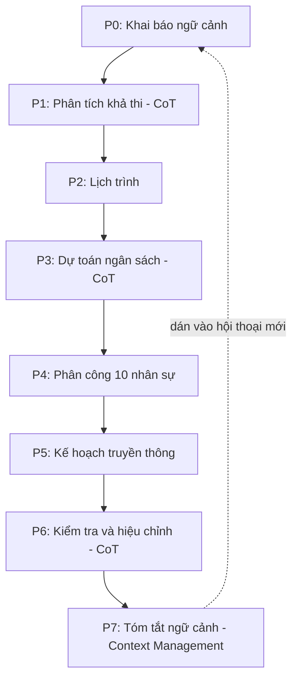

# Bài thực hành 7: Kế hoạch tổ chức sự kiện AI Innovation Day

**Dữ kiện cố định (không thay đổi):** 150 sinh viên · 1 ngày · tối đa 15.000.000đ · 10 nhân sự · mục tiêu: sinh viên hiểu và trải nghiệm ứng dụng AI trong học tập và công việc.

**Giả định:** mượn hội trường của trường (miễn phí), sinh viên tự mang laptop và ăn trưa tự túc, dùng wifi của trường.

---

## 1. Bộ prompt hoàn chỉnh (kết hợp 3 kỹ thuật)



| Kỹ thuật | Dùng ở đâu |
|---|---|
| **Chain-of-Thought** | P1 (khả thi), P3 (tính ngân sách), P6 (kiểm tra rủi ro): yêu cầu AI "suy luận từng bước" |
| **Prompt Chaining** | P1 → P2 → P3 → P4 → P5 → P6: output trước dán vào prompt sau |
| **Context Management** | P0 (ràng buộc cố định) và P7 (bản tóm tắt để chuyển hội thoại mới) |

**P0 – Ngữ cảnh (dán đầu mỗi hội thoại):**
```
Bạn là chuyên gia tổ chức sự kiện. Dự án: "AI Innovation Day" cho CLB công nghệ.
Ràng buộc BẮT BUỘC: 150 sinh viên; 1 ngày; ngân sách tối đa 15.000.000đ;
10 nhân sự; mục tiêu: giúp sinh viên hiểu và trải nghiệm AI trong học tập và công việc.
Không được thay đổi các ràng buộc này. Trả lời ngắn gọn, dạng bảng.
```

**P1 – Khả thi (CoT):**
```
Hãy phân tích tính khả thi theo từng bước: (1) tỷ lệ nhân sự/sinh viên,
(2) chi phí bình quân/sinh viên, (3) địa điểm và thiết bị, (4) thời gian,
(5) rủi ro chính. Nêu lập luận từng bước rồi kết luận khả thi hay không.
```

**P2 – Lịch trình (dùng output P1):**
```
Dựa trên phân tích khả thi: [DÁN OUTPUT P1]
Lập lịch trình 1 ngày theo khung giờ, gồm: check-in, khai mạc, talk, workshop
thực hành, giải lao, nghỉ trưa, hoạt động trải nghiệm, trao giải. Mọi hoạt động
phải phục vụ mục tiêu "hiểu và trải nghiệm AI".
```

**P3 – Ngân sách (CoT, dùng output P1 + P2):**
```
Dựa trên: [DÁN P1] và lịch trình [DÁN P2].
Lập dự toán từng hạng mục. Hãy tính từng bước (đơn giá x số lượng), cộng tổng,
so sánh với 15.000.000đ. Nếu vượt thì cắt giảm và nêu lý do. Có khoản dự phòng.
```

**P4 – Phân công (dùng output P2 + P3):**
```
Dựa trên lịch trình [DÁN P2] và ngân sách [DÁN P3], phân công đúng 10 nhân sự:
vai trò, nhiệm vụ, hạng mục ngân sách phụ trách, thời điểm cần có mặt.
```

**P5 – Truyền thông (dùng output P2 + P4):**
```
Dựa trên lịch trình [DÁN P2] và phân công [DÁN P4], lập kế hoạch truyền thông
trước sự kiện theo mốc ngày (T-14 đến T-1): kênh, nội dung, người phụ trách,
chi phí (nằm trong hạng mục truyền thông của ngân sách [DÁN P3]).
```

**P6 – Kiểm tra và hiệu chỉnh (CoT, dùng toàn bộ):**
```
Đây là toàn bộ kế hoạch: [DÁN P1-P5]
Kiểm tra từng bước: (1) tổng ngân sách ≤ 15.000.000đ? (2) đúng 150 sinh viên?
(3) đúng 10 nhân sự? (4) hạng mục nào trong lịch trình thiếu người/tiền?
(5) rủi ro chưa có phương án? Liệt kê vấn đề, cách sửa và trả về bản kế hoạch đã chỉnh.
```

**P7 – Tóm tắt ngữ cảnh (Context Management):**
```
Hãy tóm tắt toàn bộ dự án trong tối đa 300 từ gồm: ràng buộc cố định, các quyết
định đã chốt (lịch, ngân sách, nhân sự, truyền thông), vấn đề đã sửa, việc còn
lại. Viết sao cho tôi dán vào hội thoại mới là AI tiếp tục được ngay.
```

---

## 2. Phân tích tính khả thi (CoT)

| Bước | Suy luận | Kết quả |
|---|---|---|
| 1. Nhân sự | 150 sinh viên / 10 nhân sự | 1 nhân sự cho 15 sinh viên: đủ |
| 2. Chi phí | 14.700.000đ / 150 sinh viên | ≈ 98.000đ/sinh viên: hợp lý cho sự kiện miễn phí |
| 3. Địa điểm, thiết bị | Hội trường trường (có sẵn), sinh viên dùng laptop cá nhân | Không tốn chi phí thuê |
| 4. Thời gian | 1 ngày (07:30–16:30) | Đủ cho 2 talk + 1 workshop + 1 thử thách |
| 5. Rủi ro | Wifi yếu, diễn giả hủy, sinh viên vắng | Có phương án dự phòng (mục 7) |

**Kết luận: Khả thi**, với điều kiện xin được hội trường miễn phí.

---

## 3. Lịch trình sự kiện

| Giờ | Nội dung | Phụ trách |
|---|---|---|
| 07:30–08:15 | Check-in, phát thẻ tên | Nhân sự 10, 9, 6 |
| 08:15–08:30 | Khai mạc | Nhân sự 2 (MC) |
| 08:30–09:30 | Talk 1: AI trong học tập | Diễn giả 1 |
| 09:30–09:45 | Giải lao | Nhân sự 6 |
| 09:45–11:15 | Workshop: viết prompt, dùng AI làm bài, tóm tắt tài liệu | Nhân sự 3 + diễn giả 1 |
| 11:15–12:00 | Trải nghiệm các công cụ AI (booth demo) | Nhân sự 3, 4 |
| 12:00–13:30 | Nghỉ trưa (tự túc) | Nhân sự 5 dọn, chuẩn bị phòng |
| 13:30–14:30 | Talk 2: AI trong công việc và nghề nghiệp | Diễn giả 2 |
| 14:30–14:45 | Giải lao | Nhân sự 6 |
| 14:45–16:00 | AI Challenge: thi theo nhóm giải bài toán bằng AI | Nhân sự 4 + 3 |
| 16:00–16:30 | Trao giải, bế mạc, chụp ảnh | Nhân sự 1, 2 |

---

## 4. Bảng dự toán ngân sách

| STT | Hạng mục | Cách tính | Thành tiền (đ) |
|---|---|---|---|
| 1 | Backdrop, standee, trang trí | Trọn gói | 1.200.000 |
| 2 | Thù lao/quà diễn giả | 2 người × 1.200.000 | 2.400.000 |
| 3 | Giải lao (nước, bánh) 2 buổi | 160 người (150 SV + 10 BTC) × 30.000 | 4.800.000 |
| 4 | Giải thưởng AI Challenge | Nhất 1.200.000 + Nhì 800.000 + Ba 500.000 | 2.500.000 |
| 5 | In ấn (thẻ tên, tài liệu, bảng) | Trọn gói | 900.000 |
| 6 | Truyền thông (poster, quảng cáo Facebook) | Trọn gói | 600.000 |
| 7 | Âm thanh, mic, dây điện | Thuê trọn gói | 800.000 |
| 8 | Áo/thẻ ban tổ chức | 10 × 50.000 | 500.000 |
| 9 | Dự phòng | ≈ 7% | 1.000.000 |
| | **TỔNG** | | **14.700.000** |
| | **Còn dư so với trần 15.000.000** | | **300.000** |

---

## 5. Bảng phân công 10 nhân sự

| # | Vai trò | Nhiệm vụ chính | Hạng mục liên quan |
|---|---|---|---|
| 1 | Trưởng ban | Điều phối tổng, làm việc với nhà trường, trao giải | Toàn bộ |
| 2 | Phó ban / MC | Dẫn chương trình, giữ đúng giờ | Lịch trình |
| 3 | Nội dung 1 | Liên hệ diễn giả, chuẩn bị workshop và booth | Diễn giả (2) |
| 4 | Nội dung 2 | Thiết kế AI Challenge, đề thi, giám khảo | Giải thưởng (4) |
| 5 | Hậu cần 1 | Hội trường, backdrop, âm thanh | Mục 1, 7 |
| 6 | Hậu cần 2 | Giải lao, vật tư, hỗ trợ check-in | Mục 3, 5 |
| 7 | Truyền thông 1 | Viết bài, thiết kế poster | Mục 6 |
| 8 | Truyền thông 2 | Quản lý fanpage, chụp ảnh/quay video ngày sự kiện | Mục 6 |
| 9 | Tài chính, đăng ký | Quản lý quỹ, danh sách đăng ký (giới hạn 150, có danh sách chờ) | Ngân sách |
| 10 | Check-in, hỗ trợ | Đón sinh viên, phát thẻ, hướng dẫn, xử lý sự cố | Mục 5, 8 |

---

## 6. Kế hoạch truyền thông trước sự kiện

Ngày sự kiện là ngày D.

| Mốc | Kênh | Nội dung | Phụ trách |
|---|---|---|---|
| D-14 | Fanpage, nhóm sinh viên | Công bố sự kiện, mở form đăng ký (giới hạn 150 chỗ) | 7, 9 |
| D-12 | Fanpage | Giới thiệu 2 diễn giả | 7 |
| D-10 | Facebook, TikTok | Teaser "AI làm được gì cho bạn?" | 7, 8 |
| D-7 | Fanpage | Công bố lịch trình, workshop, giải thưởng AI Challenge | 7 |
| D-5 | Poster, lớp học | Dán poster, nhờ giảng viên thông báo | 6, 10 |
| D-3 | Fanpage | "Còn X chỗ", nhắc đăng ký | 9 |
| D-2 | Email, Zalo | Xác nhận đăng ký, nhắc mang laptop, gửi mã check-in | 9 |
| D-1 | Fanpage | Nhắc giờ, địa điểm, sơ đồ đường đi | 7, 8 |

Ngân sách: 600.000đ (poster, quảng cáo Facebook).

---

## 7. Báo cáo kiểm tra và hiệu chỉnh (CoT)

| Bước kiểm tra | Phát hiện ở bản nháp | Cách sửa |
|---|---|---|
| 1. Ngân sách ≤ 15 triệu | Bản nháp tổng **15.800.000đ**, vượt 800.000đ (giải lao tính 180 suất = 5.400.000đ; giải thưởng 3.000.000đ) | Giải lao tính đúng 160 suất (-600.000đ); giải thưởng còn 2.500.000đ (-500.000đ). Tổng mới **14.700.000đ** |
| 2. Đúng 150 sinh viên | Form đăng ký chưa giới hạn số lượng | Giới hạn 150, thêm danh sách chờ |
| 3. Đúng 10 nhân sự | Đã đủ 10, không thêm người | Giữ nguyên |
| 4. Hạng mục thiếu người | Check-in 150 người trong 45 phút chỉ có 1 người; ngày D chưa ai chụp ảnh | Thêm nhân sự 6 và 9 hỗ trợ check-in; nhân sự 8 phụ trách chụp ảnh |
| 5. Rủi ro | Wifi yếu, diễn giả hủy, trễ giờ | Xem bảng dưới |

| Rủi ro | Phương án dự phòng |
|---|---|
| Wifi quá tải | Báo trước sinh viên dùng 4G; dùng khoản dự phòng 1.000.000đ |
| Diễn giả hủy | Có 1 diễn giả dự bị (thành viên CLB, giảng viên) |
| Sinh viên vắng | Dùng danh sách chờ để lấp chỗ |
| Trễ giờ | MC và nhân sự 2 giữ timeline, rút ngắn phần booth nếu cần |

**Kết luận:** Sau hiệu chỉnh, kế hoạch đúng 150 sinh viên, 10 nhân sự, 14.700.000đ (≤ 15.000.000đ), và lịch trình, ngân sách, phân công, truyền thông khớp nhau.

---

## 8. Bản tóm tắt ngữ cảnh (dán vào hội thoại mới)

```
[TÓM TẮT DỰ ÁN AI INNOVATION DAY]
Ràng buộc cố định: 150 sinh viên; 1 ngày; ngân sách tối đa 15.000.000đ; 10 nhân sự.
Mục tiêu: sinh viên hiểu và trải nghiệm ứng dụng AI trong học tập và công việc.
Giả định: hội trường trường miễn phí; sinh viên tự mang laptop; ăn trưa tự túc.

ĐÃ CHỐT:
- Khả thi: 1 nhân sự/15 sinh viên; ~98.000đ/sinh viên.
- Lịch trình 07:30-16:30: check-in, khai mạc, Talk 1 (AI trong học tập), workshop
  thực hành, booth trải nghiệm, nghỉ trưa, Talk 2 (AI trong công việc),
  AI Challenge theo nhóm, trao giải.
- Ngân sách 14.700.000đ: backdrop 1,2tr; diễn giả 2,4tr; giải lao 160 suất 4,8tr;
  giải thưởng 2,5tr; in ấn 0,9tr; truyền thông 0,6tr; âm thanh 0,8tr; áo BTC 0,5tr;
  dự phòng 1,0tr. Còn dư 300.000đ.
- 10 nhân sự: 1 Trưởng ban, 2 Phó ban/MC, 3-4 Nội dung, 5-6 Hậu cần,
  7-8 Truyền thông, 9 Tài chính/đăng ký, 10 Check-in.
- Truyền thông từ D-14 đến D-1 (Facebook, TikTok, poster, email/Zalo).

ĐÃ SỬA: ngân sách nháp 15,8tr (vượt) -> 14,7tr; giới hạn đăng ký 150 + danh sách chờ;
bổ sung nhân sự check-in và người chụp ảnh.

CÒN LẠI: xin xác nhận hội trường, chốt diễn giả, thiết kế poster, soạn đề AI Challenge.
Hãy tiếp tục từ đây, không thay đổi các ràng buộc cố định.
```
